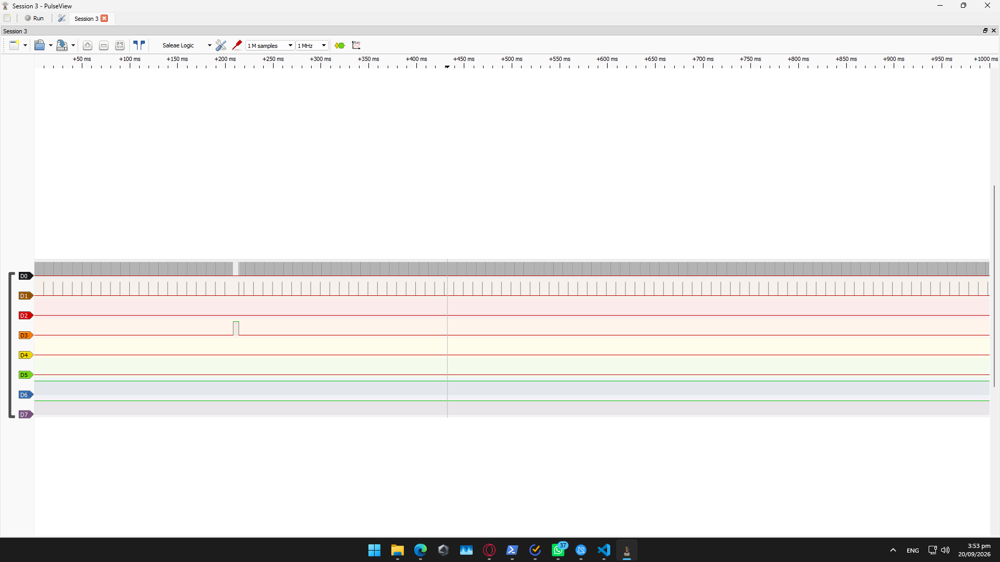
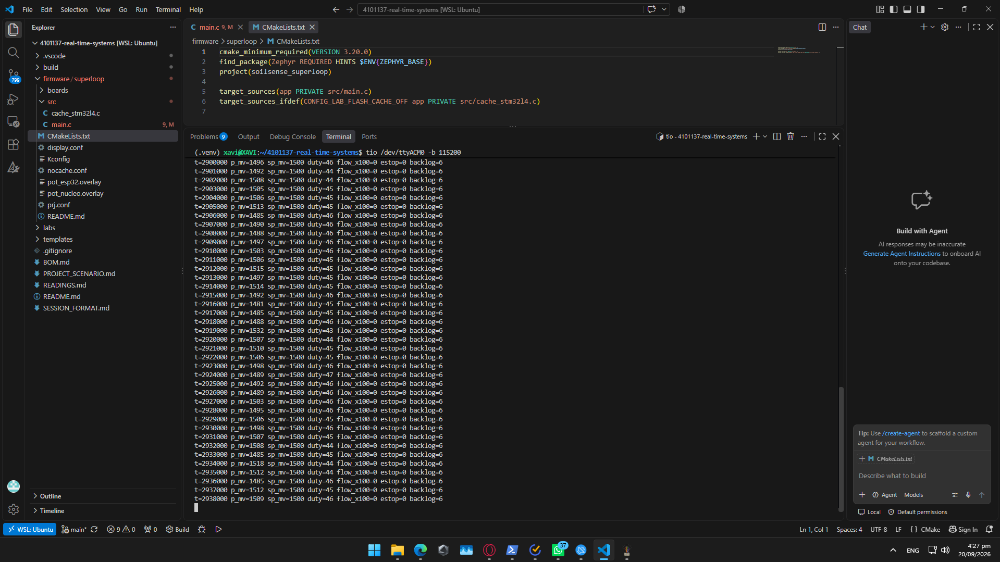
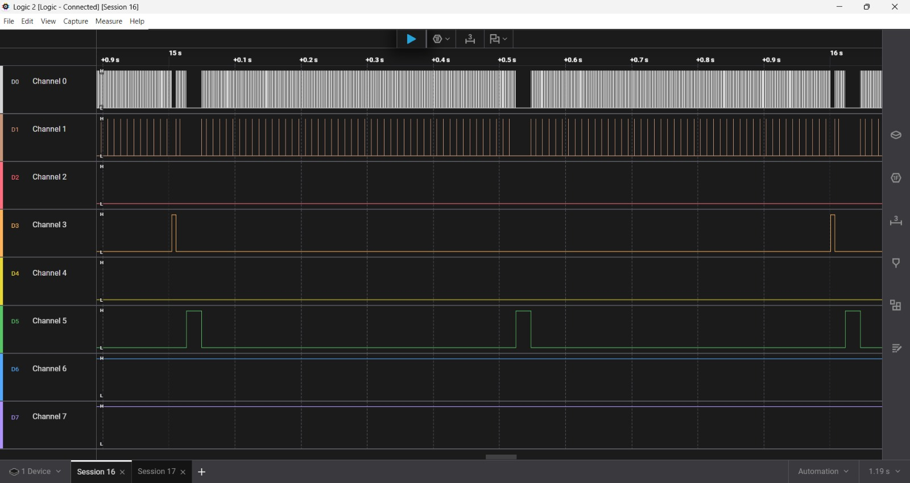
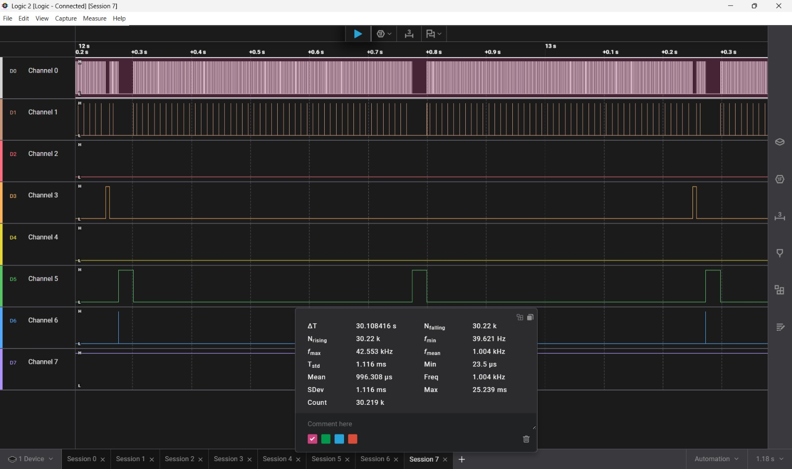
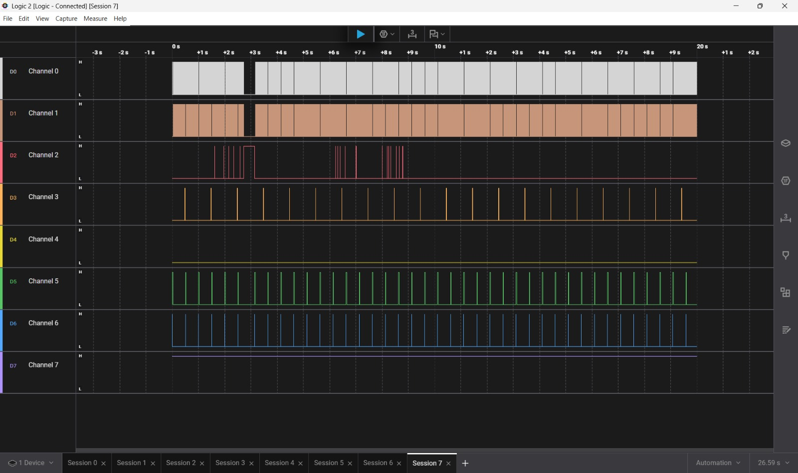

# Reporte de Laboratorio 02: Arquitectura Superloop y Mediciones

Placa: NUCLEO-L476RG · Firmware: `firmware/superloop/` · Instrumento: analizador lógico de 8 canales.

## §1 Task Set & Requirements (Task D)

### Tabla de Requerimientos EARS
| ID | Requerimiento (Formato EARS) | Ancho de Pulso ($C_i$, L476RG) |
| :--- | :--- | :---: |
| **REQ-SAMP-01** | While the system is powered on, the sampling loop shall execute every 1000 µs (deadline = period). | **6.0 µs** |
| **REQ-CTRL-01** | While the system is irrigating, the control loop shall run every 10 ms (deadline = period). | **12.5 µs** |
| **REQ-CTRL-02** | When pressure exceeds the overpressure threshold, the system shall close the valve within 5 ms. | — *(Lab 06)* |
| **REQ-LAT-01** | When a flow pulse ISR triggers, the loop service shall respond within 10 µs. | **4.2 µs** |
| **REQ-TEL-01** | While the system is irrigating, the telemetry task shall transmit one CSV line every 1000 ms. | **45.0 µs** |
| **REQ-FLOW-01** | When 100 flow pulses have accumulated, the system shall compute the flow batch within 100 ms. | — |
| **REQ-DISP-01** | While the system is operating, the display task shall refresh the HMI every 500 ms. | — |
| **REQ-CONS-01** | When the `calib` command is received, the system shall complete the calibration within 1 s. | — *(Lab 06)* |
| **REQ-CONS-02** | When any other console command is received, the system shall respond within 50 ms. | — |

---

## §2 Diagrama de Flujo del Firmware (Task A)

```text
 [1. Timer ISR (1 kHz)] ---> Activa flag de hardware e incrementa 'ticks_pending'
 [   Flow ISR         ] ---> Incrementa 'flow_pulses' por cada pulso
            |
            v
 [2. Bucle principal while(1)]
            |
            v
 [3. Tareas no críticas] ---> task_console() (D5), task_display() (D8), task_telemetry() (D6)
            |
            v
 [4. ¿ticks_pending > 0?]
            |---> SÍ: Decrementa 'ticks_pending'
            |          |
            |          +---> [5. task_sampling()] ---> Conmuta GPIO D3 (Ci = 6.0 us)
            |          |
            |          +---> [6. ¿control_div >= 10?] ---> SÍ: task_control() ---> Conmuta GPIO D4
            |
            +---> NO
                       v
            [7. task_flow_batch()] ---> Conmuta GPIO D7 (si flow_pulses >= 100)
            |
            +---> vuelve a [3]
```

### Evidencia de ejecución (firmware corriendo e instrumentación activa)





## §3 Evidencias y Tabla de Línea de Base (Task B & Task C)

**Condiciones de medición.** Analizador lógico (Saleae Logic 2) sobre los GPIO de instrumentación, estadística de periodo del canal de muestreo (CH0, `instr_samp`). Línea base: captura de **30.09 s** sin comandos en la consola. Caché apagada: captura de **30.11 s** tras recompilar con `-DEXTRA_CONF_FILE=nocache.conf`. Comando bloqueante: captura de **20.02 s** durante la cual se ejecuta `calib` (1000 rondas de lectura + `k_busy_wait(400)`).

### Tabla de Mediciones de la Línea de Base
| Measurement | Your value | Reference / Description | Verifies REQ |
| :--- | :---: | :--- | :--- |
| **Actual sampling period (nominal 1 kHz): average** | **996.03 µs** | Media del periodo de CH0 en 30.09 s (30 197 periodos) | REQ-SAMP-01 |
| **Sampling jitter: max over ≥ 30 s** | **22 578 µs** | Periodo máximo 23 577.75 µs − 1000 µs. Línea base del curso, caché activa | REQ-SAMP-01 |
| **ISR → loop-service latency (flow pulse)** | **4.2 µs** | Flanco del pulso de caudal → reacción del lazo | REQ-LAT-01 |
| **Sampling jitter, max, with the flash cache off** | **24 239 µs** | Periodo máximo 25 239 µs − 1000 µs; +1 661 µs respecto a la fila 2 por desactivar el acelerador ART | REQ-SAMP-01 |
| **Sampling jitter with the blocking command active** | **437 588 µs** | Periodo máximo 438 588.31 µs − 1000 µs durante `calib` | REQ-SAMP-01 |
| **backlog_peak, idle → during the blocking command** | **30 → 440 ticks** | Conteo interno del firmware (`status`) | REQ-SAMP-01 |

#### 1. Línea base, caché activa (CH0, 30 s)



| Parámetro | Valor | Parámetro | Valor |
| :--- | :--- | :--- | :--- |
| $\Delta T$ | 30.087168 s | $N_{\text{rising}}$ | 30 198 |
| $f_{\text{min}}$ | 42.413 Hz | $f_{\text{max}}$ | 61 776.062 Hz |
| $f_{\text{mean}}$ | 1003.981 Hz | Mean | 996.03 µs |
| SDev | 1045.42 µs | Max | **23 577.75 µs** |
| Count | 30 197 | Min | 16.19 µs |

#### 2. Caché de Flash desactivada (`nocache.conf`)



Periodo máximo de CH0: 25 239 µs → jitter máximo **24 239 µs**.

#### 3. Comando bloqueante `calib` activo (CH0, 20 s)



| Parámetro | Valor | Parámetro | Valor |
| :--- | :--- | :--- | :--- |
| $\Delta T$ | 20.015616 s | $N_{\text{rising}}$ | 20 088 |
| $f_{\text{min}}$ | 2.280 Hz | $f_{\text{max}}$ | 42 553.191 Hz |
| $f_{\text{mean}}$ | 1003.635 Hz | Mean | 996.38 µs |
| SDev | 3282.80 µs | Max | **438 588.31 µs** |
| Count | 20 087 | Min | 23.50 µs |

Consola durante la prueba:

```text
t=23000 ... backlog=30
calib
calibrating zero-flow offset (1000 rounds)...
calibration done
t=25000 ... backlog=440
...
status
p=1489 mV sp=1500 mV duty=45% flow_x100=0 estop=0 batches=0 backlog_peak=440
```

### Lectura de Un Enunciado (One-sentence reading)
El superloop cumple el periodo de 1 ms solo en promedio (996.03 µs): su jitter máximo en reposo ya es de 22.6 ms, sube a 24.2 ms sin el acelerador ART y llega a 437.6 ms con un solo comando bloqueante, así que no satisface REQ-SAMP-01.

### Análisis de Causa Raíz (Task C)
La tarea que sufre es `task_sampling()` y, con ella, `task_control()`, que depende del mismo bloque de ticks. En `cmd_calib()` (`firmware/superloop/src/main.c`) la línea `k_busy_wait(400);` se ejecuta 1000 veces dentro de `task_console()`: son ≈ 400 ms de espera activa en el único hilo de ejecución. Mientras tanto el `while(1)` no vuelve al bloque que consume `ticks_pending`, y los ticks que `tick_isr()` sigue generando a 1 kHz se acumulan (`backlog_peak` pasa de 30 a 440, es decir ≈ 440 ms de atraso, coherente con los 437.6 ms medidos por el analizador). La interrupción no es el problema: el superloop no tiene forma de interrumpir una tarea sondeada a mitad de su ejecución.
