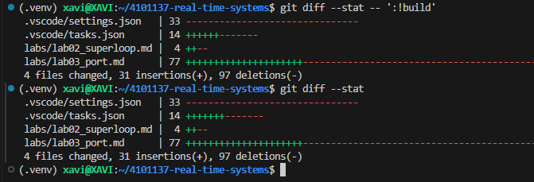
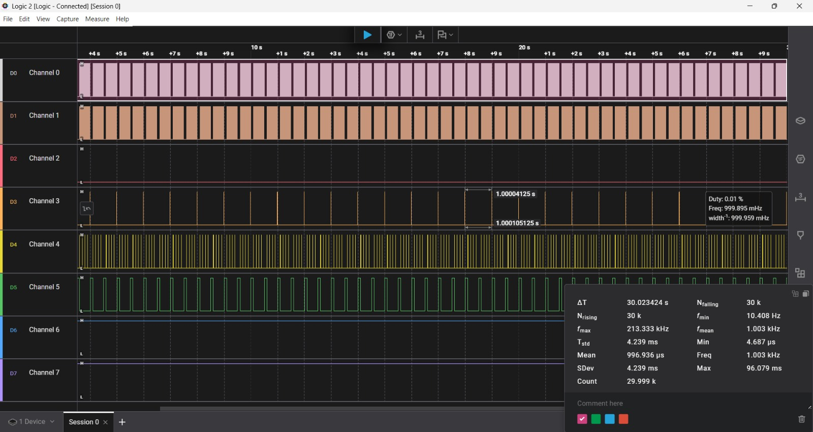
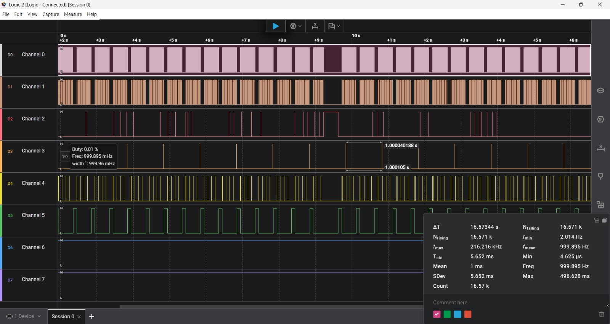
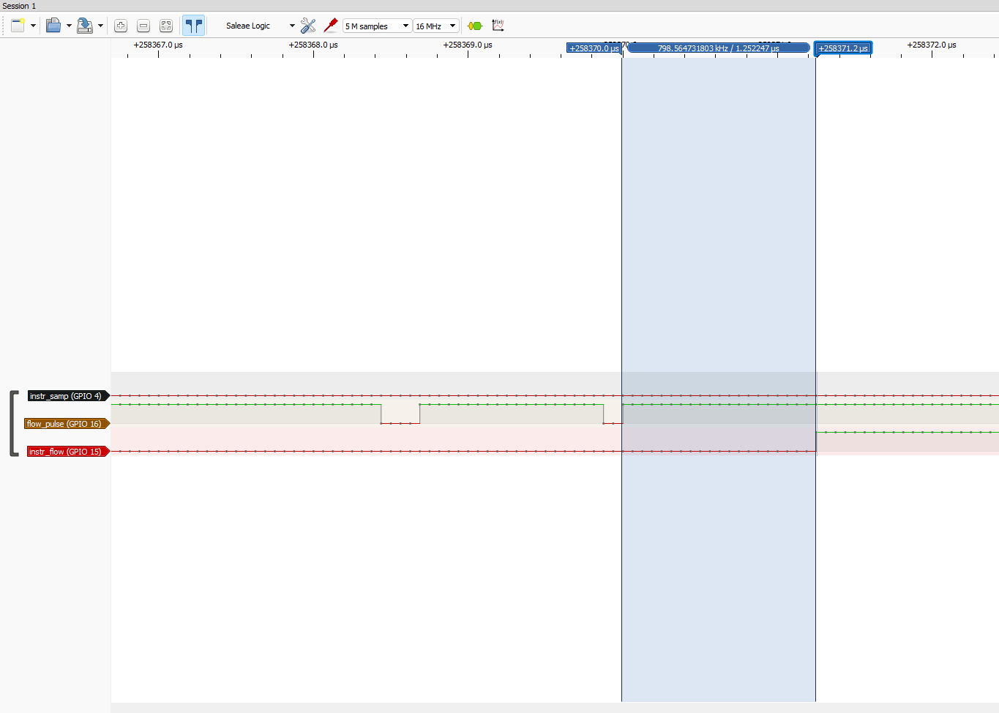
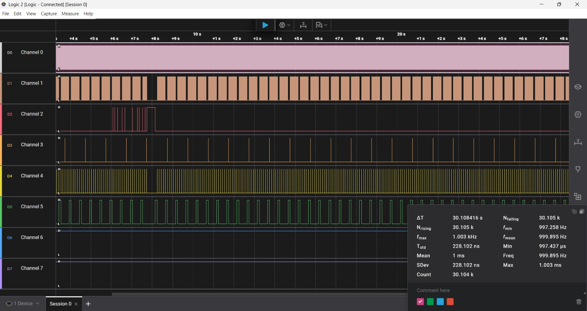
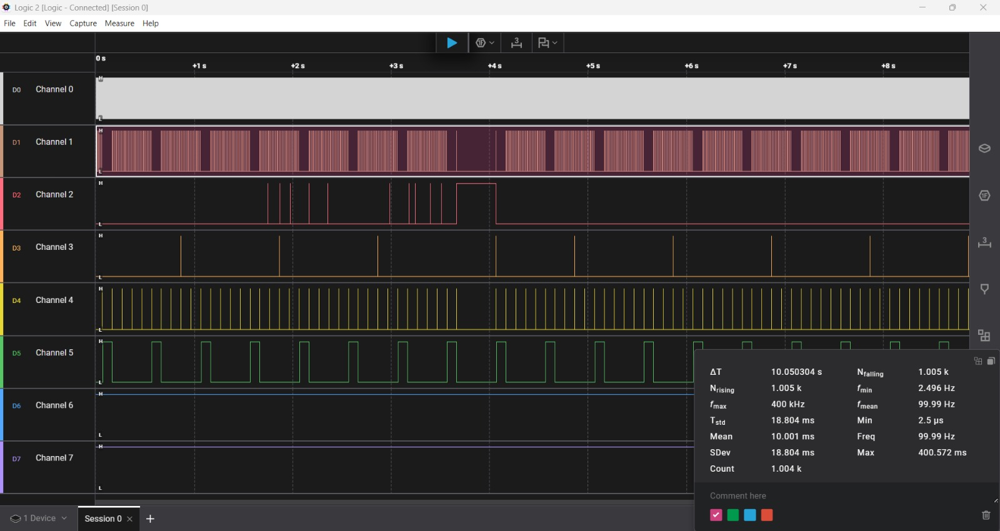

# Reporte de Laboratorio 03: Port a ESP32-S3 y Primer Thread en Zephyr RTOS

> **Contexto del Proyecto:**
> *"Eng. Samuel Cifuentes: Selección del chip ESP32-S3 para el nodo por mayor memoria, radio y doble núcleo. Evaluación de la arquitectura: migración del superloop al ESP32-S3 sin reescribir código C (usando únicamente un Devicetree Overlay) y posteriormente evaluación del primer hilo (Thread) del Kernel de Zephyr."*

---

## §1 Task Set & Tabla de Mediciones ("What You'll Measure")

### Tabla Comparativa de Desempeño

| Medición | L476RG Superloop (Semana 2) | ESP32-S3 Superloop (Task B) | ESP32-S3 + Sampling Thread (Task C) |
| :--- | :---: | :---: | :---: |
| **Max sampling jitter, ≥ 30 s en reposo** | 22 578 µs | **95 079 µs** | **3.00 µs** |
| **Max sampling jitter, `calib` activo** | 437 588 µs | **495 628 µs** | **3.00 µs** |
| **`backlog_peak`, `calib` activo** | 440 ticks | **496 ticks** | **0 ticks** |
| **`lat_peak_us` (tick → inicio del hilo, `status`)** | — | — | **7 µs** |
| **Max control period (`instr_ctrl`), `calib` activo** | — | **1147.23 ms** | **400.57 ms** |
| **ISR → service latency (pulso de caudal)** | 4.2 µs | **1.25 µs** | — |

---

## §2 Task A — El Port (Devicetree en Acción)

### 1. Reasignación de Hardware mediante Devicetree Overlay
Para adaptar el firmware `superloop` al ESP32-S3 sin modificar el código fuente en C (`main.c`), se definió el archivo de superposición de hardware:
* **Archivo:** `firmware/superloop/boards/esp32s3_devkitc_esp32s3_procpu.overlay`
* **Objetivo:** Mapear las salidas de instrumentación (GPIOs de medición) a los pines del ESP32-S3 DevKit: todos los pines en `&gpio0` (GPIO4–7, 15 y 17), la válvula como nodo `gpio-leds` en GPIO21 con alias `led0`, la entrada de caudal en GPIO16 y el SSD1306 bajo `&i2c0` con `status = "okay"`.

### 2. Análisis del Costo del Port (`git diff --cached --stat`)
El principio clave de separación de hardware y software en Zephyr RTOS permite portar aplicaciones entre arquitecturas distintas. Línea del ESP32-S3 en la salida de `git add -A && git diff --cached --stat`:

```text
 .../rts/firmware/superloop/boards/esp32s3_devkitc_esp32s3_procpu.overlay    |  62 ++++++++++++++++++++++++++++
```

El port al ESP32-S3 cuesta **un archivo nuevo de 62 líneas y 0 líneas de C**. El mismo commit agregó los overlays de las otras placas del curso (`nucleo_l476rg`, `stm32c0116_dk`, `esp32c6_devkitc_hpcore`), tampoco con cambios en C.

### 3. Evidencia de Ejecución en Hardware Real



Respuesta del comando `status` en el ESP32-S3:

```text
p=1490 mV sp=1500 mV duty=47% flow_x100=102 estop=0 batches=130 backlog_peak=96
```

## §3 Task B — ESP32-S3 Superloop Performance

Se repitió el protocolo de la Semana 2 (captura ≥ 30 s en reposo y captura con `calib`) sobre el superloop portado al ESP32-S3 DevKit.

### 1. $C_i$ medidos en el ESP32-S3 (superloop)

| Tarea | Canal | $C_i$ |
| :--- | :--- | :---: |
| Sampling (`task_sampling`) | CH0 (`instr_samp`) | 2.688 µs |
| Control (`task_control`) | CH1 (`instr_ctrl`) | 0.312 µs |
| Console (`task_console`) | CH2 (`instr_cons`) | 2.188 µs |
| Telemetry (`task_telemetry`) | CH3 (`instr_tele`) | 64.813 µs |
| Flow batch (`task_flow_batch`) | CH4 (`instr_flow`) | 2.438 µs |
| Display (`task_display`) | CH5 (`instr_disp`) | 95.578 ms |

### 2. Evidencia de Medición

Captura en reposo (CH0): periodo máximo 96 079 µs → jitter máximo **95 079 µs**.



Captura con `calib` activo (CH0): periodo máximo 496 628 µs → jitter máximo **495 628 µs**.



Consola durante `calib`:

```text
t=55000 p_mv=1480 sp_mv=1500 duty=46 flow_x100=102 estop=0 backlog=96
status
p=1509 mV sp=1500 mV duty=46% flow_x100=102 estop=0 batches=577 backlog_peak=96
calib
calibrating zero-flow offset (1000 rounds)...
calibration done
t=62000 p_mv=1536 sp_mv=1500 duty=44 flow_x100=102 estop=0 backlog=496
status
p=1488 mV sp=1500 mV duty=46% flow_x100=102 estop=0 batches=661 backlog_peak=496
```

Periodo de control (CH1, `instr_ctrl`) con `calib` activo, 16.57 s de captura:

| Parámetro | Valor | Parámetro | Valor |
| :--- | :--- | :--- | :--- |
| $\Delta T$ | 16.573440 s | $N_{\text{rising}}$ | 41 |
| Mean | 281.56 ms | SDev | 321.36 ms |
| Min | 85.19 µs | Max | **1.147232 s** |

Latencia ISR → servicio del pulso de caudal:



### 3. Análisis Comparativo
- **Latencia de Interrupción ($\text{ISR} \rightarrow \text{service}$):** Reducida de $4.2\,\mu\text{s}$ (STM32L476RG) a $1.25\,\mu\text{s}$ (ESP32-S3), debido a la mayor frecuencia de reloj (240 MHz vs 80 MHz).
- **¿Qué diferencia de hardware explica el cambio del máximo en reposo?** En el ESP32-S3 el jitter máximo (95 079 µs) coincide con el ancho de `instr_disp` (95.578 ms): el redibujado completo de la pantalla SSD1306 por I²C bloquea el bucle y fija el peor caso. La telemetría ya no pesa: `uart_stm32_poll_out` espera a que el registro de transmisión quede libre en cada carácter, mientras que `uart_esp32_poll_out` deposita el carácter en la FIFO de transmisión de 128 bytes y retorna, por eso `instr_tele` mide solo 64.8 µs en el S3.
- **¿Dónde aparecen el reloj y la caché?** En los anchos de pulso $C_i$, no en el máximo: a 240 MHz `sampling` baja de 6.0 µs a 2.688 µs y `control` de 12.5 µs a 0.312 µs, aunque el código se ejecute desde Flash SPI externa a través de la caché. El máximo lo fija la tarea que más tiempo retiene el bucle (la pantalla en reposo, `calib` con el comando activo), y `calib` dura ≈ 400 ms en ambos chips porque es una espera por tiempo, no por instrucciones.

## §4 Task C: Migración a Kernel Thread de Zephyr

### 1. Arquitectura del Hilo
Para eliminar el jitter introducido por tareas bloqueantes en el superloop (como la rutina de calibración `calib`), se migró la lógica de muestreo a un *Kernel Thread* dedicado; el resto de tareas, incluido el control, sigue en el superloop de `main`:

* **Nombre del Hilo:** `sampling_thread`
* **Prioridad:** `2` (preemptiva, por encima de `main`, que baja a 10 con `CONFIG_MAIN_THREAD_PRIORITY=10`)
* **Tamaño de Stack:** `1536` bytes
* **Mecanismo de Sincronización:** la ISR del timer encola el instante de liberación (`k_cycle_get_32()`) en `tick_q` (`k_msgq`) y el hilo se bloquea en `k_msgq_get(&tick_q, ...)`.
* **Control:** cada 10 muestras el hilo incrementa `control_pending`, que el bucle de `main` atiende con `task_control()`.
* **Métricas Atómicas:** latencia máxima de liberación mediante operaciones atómicas (`atomic_set` / `atomic_get` sobre `lat_peak_us`), reportada por `status`.

### 2. Evidencia

```text
t=2000 p_mv=1504 sp_mv=1500 duty=45 flow_x100=102 estop=0 backlog=0
status
p=1497 mV sp=1500 mV duty=45% flow_x100=102 estop=0 batches=55 backlog_peak=0 lat_peak_us=7
```

Muestreo (CH0) con `calib` activo: periodo máximo 1003.00 µs → jitter máximo **3.00 µs**, igual que en reposo.



Control con `calib` activo: periodo medio 10.001 ms, pero periodo máximo **400.572 ms**.



### 3. Análisis de Resultados y Desempeño

1. **¿`calib` sigue arruinando el muestreo?** No. El muestreo corre en un hilo de prioridad 2 que desaloja a `main` cada milisegundo, así que ningún tick se pierde ni se retrasa: jitter máximo de 3.00 µs con y sin `calib`, `backlog_peak` = 0 y `lat_peak_us` = 7 µs.
2. **¿Y el control?** Sí, sigue degradado. `task_control()` todavía se ejecuta en el bucle de `main`: la bandera `control_pending` se activa a tiempo, pero mientras `calib` ocupa `main` durante ≈ 400 ms nadie la atiende, y el periodo de control se estira hasta 400.57 ms.
3. **Estado compartido entre hilos.**
   * `pressure_mv`: la escribe `sampling_thread`; la leen `task_control`, `task_telemetry`, `task_display` y la consola (en `main`).
   * `estop`: la escribe `sampling_thread` (sobrepresión, y el joystick, porque `joystick_update()` se llama dentro de `task_sampling()`) y `main` (comando `clear`); la lee `task_control` (en `main`).
   * `setpoint_mv`: la escribe `sampling_thread` (joystick) y `main` (comando `set`); la lee `task_control` (en `main`).

   El código no falla sin mutex porque el ESP32-S3 ejecuta estos hilos en un solo núcleo y cada lectura o escritura de un entero de 32 bits alineado es una única instrucción de carga o almacenamiento, que una interrupción no puede partir a la mitad. Esto no protege las operaciones leer-modificar-escribir (por ejemplo `setpoint_mv = CLAMP(setpoint_mv + 10, ...)` desde dos hilos); el firmware del nodo (`firmware/kernel`) usa `atomic_t` para todo el estado compartido y el Lab 06 fija la política de exclusión mutua (ADR-002).
