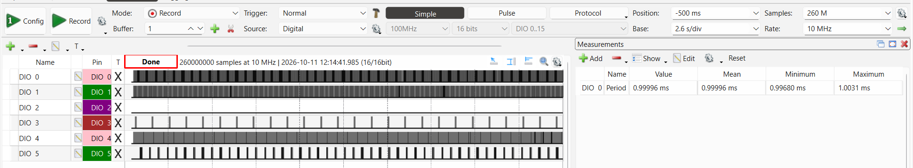
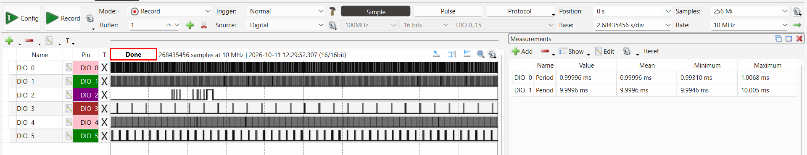
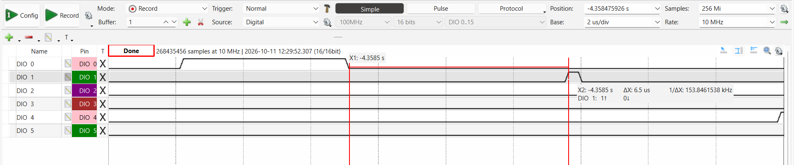

# Lab 04 / Week 4 — Migration to Preemptive Kernel & A/B Benchmark

Placa: ESP32-S3 DevKitC-1 · Firmware: `firmware/kernel/` · Instrumento: analizador lógico (Digilent WaveForms, 10 MHz).

## §1 Tabla Comparativa de Mediciones (A/B Test)

Mismo protocolo que en las Semanas 2 y 3 (captura ≥ 30 s en reposo y captura con `calib`), mismos GPIO de instrumentación.

| Medición (ESP32-S3) | Superloop (Semana 3) | Kernel Threads (Semana 4) |
| :--- | :---: | :---: |
| **Max sampling jitter (reposo)** | 95 079.06 µs | **3.1 µs** |
| **Max sampling jitter (con `calib` bloqueante)** | 495 628.44 µs | **6.8 µs** |
| **Max control period (con `calib`)** | 1147.23 ms | **10.005 ms** |
| **ISR → thread latency (`lat_peak_us`)** | — | **8 µs** |
| **Ancho visible de cambio de contexto (Task C)** | — | **6.5 µs** |
| **Overhead estimado de CPU por conmutaciones** | — | **≈ 1.7 %** |
| **Control thread stack high-water mark** | — | **288 B / 1024 B (28 %)** |

---

## §2 ADR-001 — Node Architecture: Multithreaded Kernel

* **Status:** Accepted
* **Date:** 2026-10-27
* **Deciders:** Real-Time Systems Engineering Team

### Context
En el superloop, el comando de consola `calib` (≈ 400 ms de espera activa) congela el único hilo de ejecución. En el ESP32-S3 eso llevó el jitter máximo de muestreo a **495 628.44 µs** y el periodo máximo de control a **1147.23 ms** (Semana 3), muy por encima de REQ-SAMP-01 (1 ms) y REQ-CTRL-01 (10 ms). Con el primer hilo de la Semana 3 el muestreo quedó protegido, pero el control siguió degradándose hasta 400.57 ms porque todavía vivía en el bucle de `main`.

### Decision
Migrar todo el nodo ESP32-S3 a hilos preemptivos de Zephyr, en orden rate-monotonic (menor periodo, mayor prioridad):

| Hilo | Ejecuta | Despertado por | Prioridad | Stack |
| :--- | :--- | :--- | :---: | :---: |
| `sampling_thread` | `task_sampling` | `tick_q` (`k_msgq` con el instante de liberación) | 2 | 1536 B |
| `control_thread` | `task_control` | `control_sem` (`k_sem`), dado por sampling cada 10 muestras | 3 | 1024 B |
| `flow_wq` (workqueue propia) | `task_flow_batch` | la ISR de caudal, al acumular 100 pulsos | 5 | 1024 B |
| `display_thread` | `task_display` | `k_msleep(50)` | 7 | 2048 B |
| `telemetry_thread` | `task_telemetry` | `k_sleep(K_TIMEOUT_ABS_MS(next))`, `next += 1000` | 8 | 2048 B |
| `console_thread` | `task_console` | sueño de 5 ms entre sondeos | 9 | 2048 B |

1. **Workqueue propia para el lote de caudal.** La *system workqueue* corre en prioridad −1 (cooperativa): un lote en ella no podría ser desalojado ni por `sampling`. `flow_wq` corre en prioridad 5, preemptible.
2. **Todo hilo se bloquea.** Ningún hilo sondea sin dormir; la consola duerme 5 ms entre sondeos (la FIFO de recepción de 128 bytes guarda ≈ 11 ms a 115200 baudios), así el hilo `idle` recibe el tiempo libre.
3. **`main` solo inicializa.** `main` corre en prioridad 10 (`CONFIG_MAIN_THREAD_PRIORITY=10`); los hilos se crean retenidos (`SYS_FOREVER_MS`) y `main` los arranca con `k_thread_start()` después de `init_hw()`, de modo que ninguno toca un pin antes de que el hardware esté configurado. Luego arranca el timer de 1 kHz y retorna.

### Justification
La prueba A/B (§1), con el mismo protocolo de la Semana 2, confirma que el kernel mejora el peor caso, no solo el promedio:
* **Muestreo:** el jitter máximo con `calib` baja de 495 628.44 µs a **6.8 µs**.
* **Control:** el periodo máximo con `calib` baja de 1147.23 ms a **10.005 ms**, dentro de REQ-CTRL-01.
* **Latencia de liberación:** `lat_peak_us` = **8 µs** del tick del timer al inicio de `sampling_thread`.

### Consequences & Costs
* **Beneficio:** el peor caso de las tareas duras ya no depende de lo que haga la consola: `calib` sigue girando 400 ms, pero en el hilo de menor prioridad.
* **Costo 1 — CPU de conmutación:** **6.5 µs** por cambio de contexto visible (Task C), ≈ **1.7 %** de la CPU con la carga actual.
* **Costo 2 — memoria:** una pila por hilo, 9.5 KB en total para los seis hilos de la aplicación. La medición de la Task D mostró que las pilas más cerca del límite no eran las de la aplicación sino las del kernel: ISR0 al 87 % (512 B) e `idle` al 81 % (256 B). La configuración actual del nodo (`firmware/kernel/prj.conf`) usa `CONFIG_ISR_STACK_SIZE=2048`.
* **Costo 3 — concurrencia:** el estado compartido entre hilos e ISRs pasa a ser `atomic_t`, y los locks entre prioridades distintas quedan regidos por ADR-002 (Lab 06).

---

## §3 Week-4 Evidence

### Task A — Migración Completa de la Arquitectura
Los seis hilos y la workqueue de §2 corren en el nodo; `status` responde, la telemetría llega cada segundo y la presión sigue al setpoint:

```text
status
p=1502 mV sp=1500 mV duty=46% flow_x100=0 estop=0 batches=0 backlog_peak=0 lat_peak_us=8
```

Se preservaron los mismos GPIO de instrumentación de las Semanas 2 y 3 (`instr_samp` GPIO4, `instr_ctrl` GPIO5, `instr_cons` GPIO6, `instr_tele` GPIO7, `instr_flow` GPIO15, `instr_disp` GPIO17) para garantizar la simetría de la comparación.

### Task B — Comparativa A/B y Capturas
**Reposo, ≥ 30 s (DIO0 = `instr_samp`):** periodo máximo 1003.1 µs → jitter máximo **3.1 µs**.



**Con `calib` activo (DIO0 = `instr_samp`, DIO1 = `instr_ctrl`):** periodo de muestreo entre 0.99310 y 1.0068 ms → jitter máximo **6.8 µs**; periodo de control entre 9.9946 y **10.005 ms**.



### Task C — Medición de Costo y Cálculo de Overhead
Cada 10 muestras, `sampling` da el semáforo de `control` y luego se bloquea en `tick_q`: el hueco entre la bajada de `instr_samp` y la subida de `instr_ctrl` es un cambio de contexto más las llamadas al kernel que lo rodean.



**Hueco visible medido: 6.5 µs** (cursores de WaveForms entre la bajada de DIO0 y la subida de DIO1).

Conmutaciones por segundo con la carga actual:

$$\underbrace{1000 \times 2}_{\text{sampling: entra y sale}} + \underbrace{100}_{\text{control}} + \underbrace{200 \times 2}_{\text{consola cada 5 ms}} + \underbrace{20 \times 2}_{\text{display cada 50 ms}} + \underbrace{1 \times 2}_{\text{telemetría}} \approx 2\,542\ \text{conmutaciones/s}$$

$$\text{Overhead} \approx 2\,542 \times 6.5\ \mu\text{s} = 16.5\ \text{ms/s} \approx 1.7\,\%\ \text{de la CPU}$$

### Task D — Seguridad de Memoria (Stack High-Water Mark)

Con `CONFIG_THREAD_NAME=y`, `CONFIG_THREAD_ANALYZER=y` y `CONFIG_THREAD_ANALYZER_USE_PRINTK=y`, el comando `threads` llama a `thread_analyzer_print()`. Salida bajo carga (pulsos de caudal, HMI y un `calib`):

```text
threads
Thread analyze:
 flow_wq             : STACK: unused  720 usage  304 / 1024 ( 29 %); CPU:   0 %
                     : Total CPU cycles used: 1096
 telemetry_tid       : STACK: unused 1296 usage  752 / 2048 ( 36 %); CPU:   0 %
                     : Total CPU cycles used: 33451108
 sampling_tid        : STACK: unused 1232 usage  304 / 1536 ( 19 %); CPU:   0 %
                     : Total CPU cycles used: 1833786319
 display_tid         : STACK: unused 1344 usage  704 / 2048 ( 34 %); CPU:   0 %
                     : Total CPU cycles used: 771092000
 control_tid         : STACK: unused  736 usage  288 / 1024 ( 28 %); CPU:   0 %
                     : Total CPU cycles used: 226216062
 console_tid         : STACK: unused 1056 usage  992 / 2048 ( 48 %); CPU:   0 %
                     : Total CPU cycles used: 359597549
 sysworkq            : STACK: unused  208 usage  304 /  512 ( 59 %); CPU:   0 %
                     : Total CPU cycles used: 968
 idle                : STACK: unused   48 usage  208 /  256 ( 81 %); CPU:  99 %
                     : Total CPU cycles used: 481479107710
 ISR0                : STACK: unused   64 usage  448 /  512 ( 87 %); CPU:   0 %
                     : Total CPU cycles used: 0
```

**Conclusión de Seguridad:** entre los hilos de la aplicación, el más cercano a su límite es `console_tid` (48 %, 1056 B libres), con margen amplio. Las pilas más comprometidas son las del kernel: **ISR0 al 87 % (64 B libres)** e **`idle` al 81 % (48 B libres)**, que por eso se dimensionan aparte en `prj.conf`. La pila de `control_tid` usa 288 de 1024 B (28 %).
